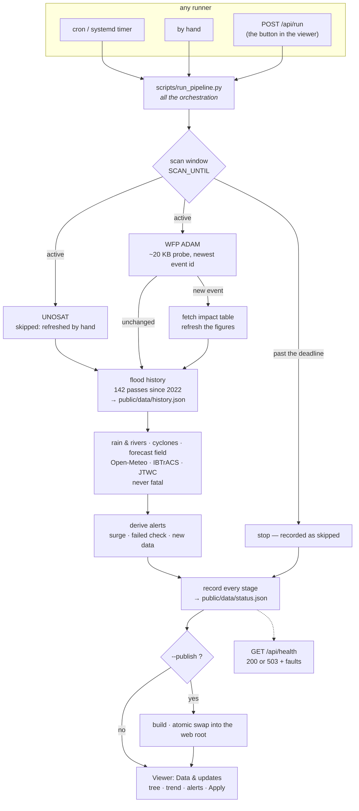

# myanmar-flood-viewer

A map viewer for flooding in Myanmar, from three sources that answer different questions:

- **UNOSAT FloodAI** — an AI detector over Sentinel-1, covering the **whole country** and refreshed
  as imagery arrives. One point per township: people exposed, flooded area, flooded cropland.
  This is the layer that tells you *how many people are under water, where, right now*.
- **UNOSAT hand-traced extents** — precise flood outlines, but only for four regions and only for
  the dates an analyst processed. Observed extent, with **no depth attached**.
- **WFP ADAM** — event-level impact by administrative unit, as a cross-check on the above.

The traced extents cover about a fifth of the people the nationwide layer counts — Sagaing and
Ayeyarwady are usually worst hit and have no traced outline here at all.

Self-contained: it runs, updates and serves itself from one machine. No CI service, no hosting
platform, no account anywhere.

> This site is built and published by an individual. It is not an official site of UNOSAT, WFP or
> any humanitarian agency. It is not a statutory hazard map. Radar misses water under dense
> vegetation and inside buildings, so an absent polygon is not proof of dry ground.

- Flood extents: [UNOSAT via HDX](https://data.humdata.org/organization/unosat) (CC BY-SA)
- Impact figures: [WFP ADAM](https://api.adam.geospatial.wfp.org) (CC BY-SA)
- Region boundaries: [geoBoundaries](https://www.geoboundaries.org/) (ODbL)
- Basemap: [© OpenStreetMap contributors](https://www.openstreetmap.org/copyright) / [OpenFreeMap](https://openfreemap.org/)

### Licence

Code is **MIT** (see [LICENSE](LICENSE)). The flood data committed under `public/data/` is **not** —
it is UNOSAT and WFP material under **CC BY-SA**, with boundaries from geoBoundaries under **ODbL**,
and share-alike terms that MIT cannot override. Anything fetched at run time keeps its own licence
too; note that the **Cloud-free** basemap (EOX Sentinel-2 cloudless) is **CC BY-NC-SA 4.0** — the NC
means non-commercial. [NOTICE](NOTICE) spells all of this out.

### Origin

This began as [shiwaku/chiba-flood-viewer](https://github.com/shiwaku/chiba-flood-viewer), a viewer
for the August 2026 floods in Chiba, Japan, and follows the panel and theme conventions of
[shiwaku/dm-converter](https://github.com/shiwaku/dm-converter/tree/main/viewer). It has since been
rebuilt for Myanmar: different data sources, a React front end, a local server, and a pipeline that
no longer depends on any hosted CI. The Japanese data, its scanner and the Japan-only basemaps are
gone; the early commits in this repository are that original work.

## Regions

| Region | Event | Imaged | ADAM impact (people) |
|---|---|---|---:|
| Yangon Region | monsoon | 2021-08-25 & 08-31 | 962 |
| Bago Region | monsoon | 2021-08-25 & 08-31 | 153,336 |
| Mandalay Region | Typhoon Yagi | 2024-09-15 & 09-24 | — |
| Nay Pyi Taw Union Territory | Typhoon Yagi | 2024-09-15 & 09-24 | — |

Event dates differ by region because no single UNOSAT product covers all four.

> **The Yangon extent layer is nearly empty (19 polygons), and that is a limit of the imagery, not a
> finding.** The 2021 analysis extent barely reaches Yangon Region. Turn on **Estimation extent** to
> see exactly what was assessed — the boundary runs east of Yangon city.

**Every figure shown is sourced and dated.** A second set of per-region *flood risk share*
percentages was supplied to this project without a citation and shown here for a time, marked
unverified. They were removed in Aug 2026: no source could be found, they turned out to be a closed
tally (16/9/4/1 of 30 records, summing to 100% across those four regions alone) rather than a
modelled probability, and they inverted the ranking of both measured datasets — putting Yangon above
Bago where WFP ADAM has Bago at 99.4% to Yangon's 0.6%. They remain in the git history.

## Layers

| Layer | Source data | Contents |
|---|---|---|
| All surface water | `waterextent` | Every water surface detected, permanent rivers and lakes included. Drawn under the flood layers as a baseline |
| Flood water (earlier pass) | `floodextentearly` | An earlier satellite pass, where UNOSAT published two dates. What still shows through had drained by the later date |
| Detected flood water | `floodextent` | The flood extent for the main date. One flat colour — it carries no depth |
| Estimation extent | `inputarea` | The area actually analysed. Blank ground outside it means nobody looked, not that it was dry |
| People exposed | `exposure` | **Nationwide.** One circle per township, area proportional to people under detected water. The only layer measured in people rather than water |
| Observed track | `cyclones.json` | Tropical cyclones being tracked in the Bay of Bengal and West Pacific: IBTrACS provisional best track, coloured by intensity. Positions get revised |
| Forecast track | `cyclones.json` | The JTWC official forecast at 12–120 h — dashed and hollow, because it is a **forecast** |
| Wind radii | `cyclones.json` | How far 34/50/64 kt winds reach in each quadrant at the moment on the timeline. Real data, standing in for the cone Weather Lab draws |
| Forecast field | `field/` | **Weather view.** Rainfall, ensemble probability or wind from ECMWF / GFS / ICON, one frame per three-hour step |

## Running it

```bash
npm install
npm start        # build, then serve on http://127.0.0.1:5180
```

`npm start` runs the local Node server, which serves the site **and** exposes the pipeline:

| | |
|---|---|
| `GET /api/status` | the published pipeline status |
| `GET /api/run` | the state of the current or last run |
| `POST /api/run` | start a run — this is what the **Run update now** button calls |
| `GET /api/chat` | whether the assistant is configured (never the key itself) |
| `POST /api/chat` | the assistant's streamed reply |

With the server running, the panel's trigger button works. Served as plain static files the page
still works fully; it just detects there is no backend and hides the button.

## The assistant (optional)

The panel's **Assistant** tab answers questions from the data this viewer already holds. It is off
unless an API key is present. Put one in a `.env` file at the project root:

```bash
cp .env.example .env
```

then edit the one line:

```
ANTHROPIC_API_KEY=sk-ant-...
```

and start the server:

```bash
npm start
```

`.env` is gitignored. A real environment variable always wins over the file, so
`ANTHROPIC_API_KEY=sk-ant-... npm start` still works for a one-off, and a systemd
`EnvironmentFile=` overrides it in production.

Without a key everything else works exactly as before, and the tab says so rather than failing.

The key stays on the server — the browser never sees it. `POST /api/chat` pins the model, the
system prompt, the tool definitions and every sampling parameter, and accepts only the conversation
itself; anything else in the request body is rejected. The tool-calling loop runs in the browser,
because the tools that move the map act on the page's own state and the tools that compute figures
call the same code the panel renders from — so the assistant and the panel cannot disagree about
what the data says.

Answers are grounded structurally rather than by instruction. Every tool returns its dataset,
observation date and caveats alongside the figure, a chart cannot be drawn without naming its
source, and a deterministic check flags any number in the reply that appears in no tool result.

Tool definitions are validated by `npm run check:tools`, and the grounding check has unit tests in
`npm run check:grounding`. Both run at the start of every build. It enforces the constraints the Anthropic API applies at request time — the strict-tool
limit, the schema keywords strict mode forbids — so a broken tool fails locally rather than in
front of a reader.

**This is the one part of the viewer that contacts a third party.** Questions, and the data needed
to answer them, are sent to the Anthropic API. The tab says so on screen. Everything else in this
project still contacts nothing but basemap tiles.

The server binds to `127.0.0.1` and has **no authentication** — `POST /api/run` executes a pipeline
on the machine. Put a reverse proxy with auth in front of it before exposing it anywhere.

```bash
npm run dev                    # Vite dev server, http://localhost:5175
npm run serve                  # server only, against an existing dist/
PORT=8080 PUBLISH_DIR=/var/www/flood npm run serve
npm run status                 # print the pipeline status tree
```

Stack: **React + MapLibre GL JS + Vite + TypeScript**, a **zero-dependency Node server**, and a
`scripts/` directory that is **standard-library Python only** — no GDAL, no pip packages.

### Layout

```
src/App.tsx              state and layout
src/components/          Panel, Dialogs
src/useMapOverlays.ts    MapLibre lifecycle — the map lives in a ref, not in state
src/layers.ts            the data model and layer definitions
server/index.mjs         static serving + the pipeline API
```

The map is deliberately outside React's render cycle: it is a mutable imperative object, so it is
created once into a ref. The one subtlety is `style.load` — switching basemap or theme replaces the
whole style and drops every layer the app added, so they are re-added from a ref that each render
keeps current. A plain closure there would capture stale state and silently redraw the wrong data.

## The update pipeline



The dialog shows two timestamps, and the difference between them is the point:

| | Means | Comes from |
|---|---|---|
| **Data as of** | when the data itself last changed | `index.json` |
| **Last checked** | when the pipeline last looked, whether or not it found anything | `status.json` |

The dialog draws the run as a **horizontal stepper** — one node per stage, connected by a line that
fills as the work completes. During a run it moves live: the pipeline announces its plan up front
and marks each stage as it starts and finishes, so the display follows the process actually doing
the work rather than guessing. Click any node for that stage's full name, outcome, duration and
detail — including *why* a stage was skipped. A failed stage turns its node and the line after it
red, and the stepper is reachable mid-run whether the run was started here, by cron, or in another
tab.

**Trigger it yourself** from the viewer: **Data & updates → Details → Run update now**. One click
refreshes everything — FloodAI exposure, ADAM impact, the multi-year history, and the rainfall and
river forecasts. With the
local server running that button executes the pipeline on this machine; served as plain static files
it hides itself, because a static page has no backend to accept a request.

`public/data/status.json` is written on *every* run, so a quiet pipeline is distinguishable from a
broken one. It carries the full stage tree — what ran, how it went, how long it took, and on which
machine — which is the only thing the viewer needs to draw the pipeline.

When new data is found, nothing moves on the map until you press **Apply to map**. It swaps the
sources in place, so your view, layer toggles and opacity all survive.

### Self-hosting

The pipeline builds the site and hands it straight to your own web server. No git, no tokens, no
third-party service.

```bash
# one-off
python3 scripts/run_pipeline.py --publish /var/www/flood

# what it does: probe ADAM → record status → vite build → swap into /var/www/flood
```

The swap is atomic — the new site is built beside the target and renamed into place — so a visitor
never sees a half-copied directory, and a failed build leaves the previous site untouched.

**Schedule it** with cron, matching the twice-daily rhythm:

```cron
0 1,13 * * * cd /srv/flood-viewer && /usr/bin/python3 scripts/run_pipeline.py --publish /var/www/flood >> /var/log/flood.log 2>&1
```

**Point your web server at it.** The site is plain static files. nginx:

```nginx
server {
    listen 80;
    server_name flood.example.org;
    root /var/www/flood;
    index index.html;

    # The GeoJSON is a few MB and changes only when the pipeline republishes.
    location /data/ { add_header Cache-Control "public, max-age=300"; }
    # Hashed asset filenames, so these can be cached hard.
    location /assets/ { add_header Cache-Control "public, max-age=31536000, immutable"; }
}
```

Caddy, if you want HTTPS handled for you:

```caddy
flood.example.org {
    root * /var/www/flood
    file_server
}
```

**Serving under a sub-path** instead of a domain root? Vite bakes the base path into every asset
URL, so it has to be set at build time:

```bash
BASE_PATH=/flood/ python3 scripts/run_pipeline.py --publish /var/www/html/flood
```

**Requirements**: Python 3 (standard library only) and Node for the build step. Nothing else — no
GDAL, no pip packages, no database.

**Nothing in the served page talks to any third party except the basemap tiles.** The pipeline
records its own stage tree into `status.json`, so the orchestration view needs no external service.


### Monitoring

Three things are watched, and they answer different questions.

**The trend** — `scripts/history.py` reconstructs a multi-year series from every FloodAI archive
UNOSAT still publish: 142 single-pass observations from March 2022 to the current event, in
`public/data/history.json`. The panel draws it.

Two things about that chart are deliberate and worth knowing before reading it:

- **Bars, evenly spaced, not a time axis.** These are discrete satellite passes; joining them with a
  line would invent values for days nobody looked. The record also has real holes — UNOSAT keep a
  limited number of archives, and there is *nothing at all* through 2025 — so a hatched gap marker is
  drawn wherever consecutive passes are months apart, and the "vs" figure names the date it is
  comparing against rather than saying "previous pass" across a two-year jump.
- **A pass covers a strip, not the country.** A low bar can mean a narrow swath rather than less
  water, so hovering any bar shows all four measures for that pass — people, flooded area, cropland
  and the area actually observed — with the share of the observed strip that was under water.

**One archive is wrong, and the guard is a ratio rather than a name.** `AI20230724MMR` reports
population roughly 125× too high — one township credited with 13.6 million people against 575 km² of
water. Left alone it put a **107-million-person** spike on the chart, twice the population of the
country. Every observation is now checked against the ratio the other four archives agree on
(100–180 people per km² flooded, stable across 2022, 2023, 2024 and 2026); anything an order of
magnitude beyond that has its population withheld and its areas kept, drawn hollow. That catches the
*next* bad archive too, which naming this one would not. 25 observations are currently withheld and
the peak is a plausible 1,717,487 on 2024-07-30.

**Alerts** — `scripts/alerts.py`, derived on every run into `status.json`. Nothing is pushed
anywhere; they are recorded and drawn in the panel, and adding a channel later means reading the
same list. A **surge** is judged against the median of the preceding twelve passes rather than a
fixed number, because a fixed threshold is wrong the moment the usual level moves — the current
event raises one at 25× the recent median. A **failed check** is always critical, because a check
that did not complete must never be able to render as "nothing new".

**Staleness is the reader's to compute, never the file's.** A status file cannot know it has gone
stale — it goes stale by sitting still, long after it was written. So `status.json` carries the
*threshold* (`alerts.freshness.runHours`) and both the page and `/api/health` apply it to
`generatedAt` at read time. Past it, the page raises a critical alert and the verdict chip reads
**stale** instead of "up to date": a fortnight-old check is not evidence of anything current, and
saying otherwise is exactly the claim this project exists not to make.

**Pipeline health** — `GET /api/health` answers from disk on every request, so it stays honest when
the pipeline behind the server dies. **200** when the last run is recent and clean, **503** with a
`faults` array when it is not. That 503 is the one signal worth wiring to an external monitor,
because the site can be perfectly healthy and completely out of date, and only the age of the run
says so. Running it unattended is in [`deploy/`](deploy/): systemd units for a Linux server, and
`deploy/launchd/install.sh` for macOS, which has no systemd. Both keep the update job separate from
the web server, so a crashed server never silently stops the data updating.

### Weather

Three additions, and one of them changes what this map claims.

**Rainfall on the map** — NASA GIBS / GPM IMERG precipitation rate, drawn *over* the basemap rather
than replacing it, on its own date control. This is an **observation**: step it back to the day a
flood was detected and you see the rain that caused it. Its date is separate from the imagery date
because IMERG is assembled with a longer lag — asking for yesterday returns 404, so a shared control
would silently blank the layer. The key is sampled from NASA's own colour map, so it matches the
pixels; the scale is logarithmic (0.1 → 50 mm/hr), which is why heavy rain is not simply "twice as
red" as light.

**Rainfall forecast** and **river discharge** — Open-Meteo, seven days back and forward for rain,
thirty back and fourteen forward for flow (GloFAS / Copernicus). Both are **forecasts, not
observations**, which makes them the only such figures in this viewer, and the panel says so above
every reading. Forecast bars are drawn hollow so a modelled day cannot be mistaken for a measured
one, and the discharge chart carries the GloFAS ensemble envelope — its own spread widens from about
±1% tomorrow to −11%/+38% two weeks out, and a single confident line would hide that.

Rain is the input, but **river discharge is what actually overtops a bank**, and it carries rain
that fell days ago hundreds of kilometres upstream — so a river can still be rising under a clear
sky. That is why it is the default view.

**The gauge coordinates are not the towns they are named for.** GloFAS is gridded at roughly 5 km, so
a point one cell off the channel reports a local stream. Asking for "Magway" at the town's own
coordinates returned **113 m³/s**; the actual channel nearby carries **30,338** — a 270-fold error,
with nothing in the response to say it is wrong. Every coordinate in `scripts/scan_weather.py` was
found by probing a grid and keeping the largest flow, then checked against the river's known size,
and each records the flow it was chosen at so a future drift off-channel is flagged rather than
published as a hundredfold flood.

The forecast is fetched **by the pipeline, not by the page**, so the served site still contacts
nothing but the basemap tiles. The stage is never fatal: a flood map is complete without a forecast,
so an Open-Meteo outage records `skipped` instead of turning a good run red.

### Tropical cyclones

The one layer here modelled on [Google Weather Lab](https://developers.google.com/weathernext/guides/weatherlab):
observed tracks, a forecast track, wind radii, and a **timeline** under the map that moves a marker
along every storm. Bay of Bengal cyclones and West Pacific remnants are what drive Myanmar's worst
floods, so a storm belongs on the same map as the water it will leave behind.

Both sources are public and need no key, which is the only reason they can be used here:

- **Observed** — IBTrACS `ACTIVE` (NOAA NCEI, v04r01): every storm being tracked worldwide, with
  positions, winds, pressure and the 34/50/64 kt wind radii by quadrant. Positions are
  *provisional* and get revised; the panel says so. The file drops a storm the moment it
  dissipates, so `scripts/scan_cyclones.py` keeps a 30-day local memory
  (`data/cyclones_cache.json`) — otherwise the track of a cyclone that crossed the coast on Monday
  would vanish from the map on Tuesday, exactly when a reader wants to set it against the floods.
- **Forecast** — JTWC warnings (US Navy, public domain), found through their RSS feed and parsed
  from the fixed-format warning text: the analysed position and its stated accuracy, then the
  official forecast at 12/24/36/48/72/96/120 h. JTWC files the Bay of Bengal under the prefix
  **`io`** (IBTrACS calls the same basin `NI`) and the West Pacific under `wp`.

Forecast points are drawn dashed and hollow, the forecast half of the timeline is badged
**Forecast**, and the marker goes hollow once it passes the newest observation — the same rule as
the hollow forecast bars in the weather panel. **There is no cone.** JTWC publishes one number for
the analysed position's accuracy, not a growing forecast envelope, and drawing a cone from a made-up
error growth would present an invention as data. The wind radii are real and are drawn instead; the
Cone and Ensemble toggles are on the panel, disabled, saying what they need (WeatherNext 3 ensemble
members). No landfall or impact inference is made anywhere: a JTWC forecast point inside Myanmar
raises an alert that says where the forecast puts it, and refers the reader to the Department of
Meteorology and Hydrology for warnings.

The assistant reads the same file through `cyclone_tracks`, which returns winds in kt **and** km/h
so a converted figure in its answer still passes the grounding check, and carries the same rule in
its caveats: a track forecast is not a landfall prediction.

### The Weather view

A second reading of the same map, switched in the panel header and deep-linkable as
`?view=weather` — the URL hash belongs to MapLibre, which writes the camera there on every move, so
the view goes in the query string. Modelled on [Google Weather Lab](https://deepmind.google/science/weatherlab/):
a **Model** radio, a stack of **Layers**, the tropical-cyclone card, a timeline under the map and a
key bottom-right. The flood layers keep drawing underneath — a storm belongs on the same map as the
water it leaves behind — and switching views never resets what the reader turned on.

**The models are real choices, not a decoration.** ECMWF IFS 0.25° (the baseline everyone else is
measured against), GFS and ICON, all from [Open-Meteo](https://open-meteo.com/) — public, keyless,
CC BY 4.0, non-commercial. **WeatherNext 3 is listed and disabled**, wearing the exact reason from
the pipeline's own stage record, until the Google access below arrives.

| Layer | What it is |
|---|---|
| Precipitation | Rain per three-hour step, as a paletted PNG per step |
| Probability > 25 mm / 3 h | Share of the **51-member ECMWF ensemble** over the threshold |
| Probability > 50 mm / 3 h | The same for the amount that turns a wet day into a flooding one |
| Wind 10 m | Arrows pointing downwind, sized by speed, sampled every 1° |

**Only ECMWF publishes its run time.** Open-Meteo exposes `last_run_initialisation_time` for it and
nothing for GFS or ICON, so those say **"run time not published"** everywhere they appear — in the
model list, on the legend and in every assistant answer. A forecast without its run time is
undated, and this project does not print undated figures; it also does not invent one.

**The blocks are the sampling, not the weather.** A 0.25° global model read on a 0.5° grid, about
55 km a cell, drawn with nearest-neighbour resampling so the cells stay square. Smoothing them
would draw detail the model does not have.

**Runs are kept on disk** — the newest eight per model — because Open-Meteo serves only the latest,
and the timeline's `‹ Init. ›` stepper exists to compare the same moment forecast from different
starts. A model whose current run is already on disk is not fetched again, so a hand-clicked
"Run update now" costs nothing.

**The limit that bites is per minute, not per day.** Open-Meteo counts a location as a call and
refuses a burst past roughly 800 in a minute, long before the 10,000-a-day ceiling; the whole grid
is 819 points. So the scanner paces its batches, fetches every model in **one** request
(`models=a,b,c` returns a column per model, three times cheaper than three passes), and retries once
if it is refused anyway. A full run takes a couple of minutes and is never fatal: a refusal is
recorded as `skipped` with Open-Meteo's own words for it.

### WeatherNext 3 — the fourth model, gated

The second half of the Weather Lab design: a gridded AI forecast over Myanmar you can scrub through
time — 6-hour rainfall as the ensemble mean, median and 90th percentile, the **probability of
exceeding 25 / 50 / 100 mm**, and 10 m wind — from Google DeepMind's WeatherNext 3, all 64 members.

It is not among the models yet, and the reason is access rather than code — the Weather view above
is already built to receive it as a fourth entry in the same radio. WeatherNext data (Cloud
Storage, BigQuery, Earth Engine, and the Weather Lab site itself) needs a Google Account that
Google has added to its allow-list through a request form, typically in 5–7 business days; there is
no anonymous or API-key path, and the "public" statistics bucket answers 403 without one. The full
ensemble also lives in Zarr v3 chunks compressed with codecs standard-library Python cannot decode,
so this one stage runs under an isolated virtualenv of Google's own recommended libraries
(`scripts/wn3_requirements.txt`, Python 3.11+ — separate from the 3.9 the rest of `scripts/` runs on).

So the stage ships as its **gate**. `scripts/scan_weathernext.py` checks, in order, for
credentials, the virtualenv, an explicit acceptance of the terms, and the reducer, and records the
first missing one as the stage's `skipped` reason — the panel's "Data & updates" shows exactly what
is missing, the way the assistant tab explains itself without a key. The four environment variables
are documented in `.env.example`. `python3 scripts/scan_weathernext.py --check` lists everything
still missing.

**Open item — the terms.** Real-time WeatherNext output is under the *GDM Real-Time Weather
Forecasting Experimental Data Terms*, which restrict redistribution; output more than an hour old
becomes CC BY 4.0. Whether a public site may serve the field is for the operator to decide on
sign-up, which is why `WEATHERNEXT_ACCEPTED_TERMS=1` is a separate gate and `public/data/wn3/` is
gitignored: credentials alone publish nothing. The required disclaimer — an experimental AI system
whose output does not constitute official forecasts, watches or warnings; defer to the Myanmar
Department of Meteorology and Hydrology — will be on the panel and in every tool result.

Weather Lab's other model, **MetNet Global**, has no programmatic access at all and is omitted.
Ensemble cyclone tracks and a measured spread "cone" (the disabled toggles on the cyclones card) come
from the same members, once the reducer exists.

### What is and is not automated

**ADAM is polled** twice a day (~20 KB per check). Only the newest event's impact table is publicly
readable — every older one returns 403 — so there is no backfill.

**UNOSAT is not polled.** Its products are 8–282 MB and the region clipping needs hand-tuned
tolerances, boundary files and named exclusions. Automating it would produce a confidently wrong
map, so it is refreshed by hand with `scripts/convert_unosat.py` and recorded in `status.json` as
`skipped` with the reason.

### Scan deadline

Past `SCAN_UNTIL` (an env var, defaulted in `scripts/run_pipeline.py`), a run exits without doing anything. Extend the date to keep going.

## Directories

```
public/data/index.json      the dataset list, read at runtime
public/data/status.json     what the pipeline last checked and found, plus alerts
public/data/history.json    142 satellite passes since 2022 — the trend series
public/data/weather.json    rainfall and river-discharge forecasts
public/data/cyclones.json   tropical cyclones: observed (IBTrACS) and forecast (JTWC) tracks
public/data/field/          the forecast field: a manifest, and PNG frames per model run
public/data/MM_*/           converted GeoJSON per region
src/                        the viewer
scripts/common.py           shared helpers
scripts/scan_adam.py        poll WFP ADAM, refresh the impact figures
scripts/status.py           write status.json
scripts/history.py          rebuild the multi-year series from every FloodAI archive
scripts/alerts.py           derive surge / failed-check / new-data alerts
scripts/scan_weather.py     rainfall + GloFAS river discharge (verified channel cells)
scripts/scan_cyclones.py    cyclone tracks from IBTrACS ACTIVE and JTWC warnings (+ test_cyclones.py)
scripts/scan_forecast_field.py  the Open-Meteo forecast field (+ png.py, test_forecast_field.py)
scripts/scan_weathernext.py gate for the WeatherNext 3 field: records why it cannot run yet
scripts/convert_unosat.py   convert UNOSAT shapefiles (run by hand)
scripts/run_pipeline.py     the one entrypoint — scan, record, publish
server/index.mjs            static serving + the pipeline API + /api/health
deploy/                     systemd units and a cron line for running it unattended
```

A new location needs no code change — the viewer reads `index.json` at runtime. A layer kind other
than the four above does need adding to `src/layers.ts`.
